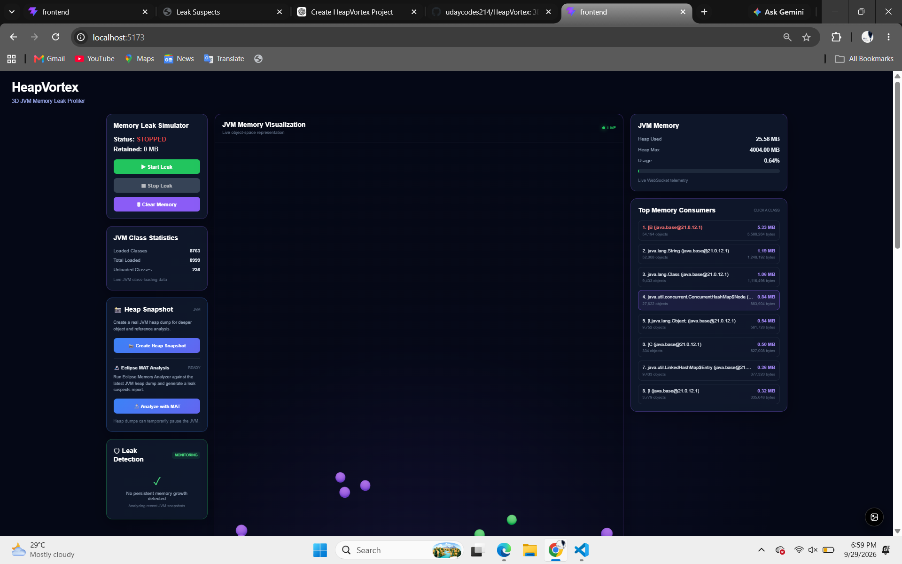
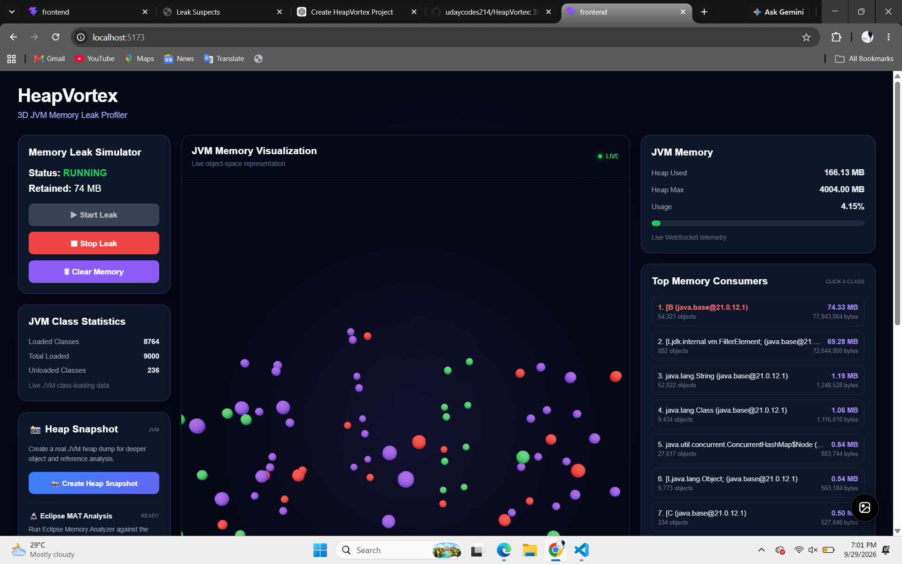
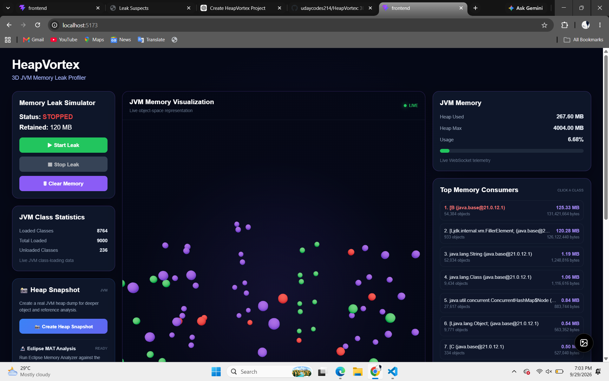
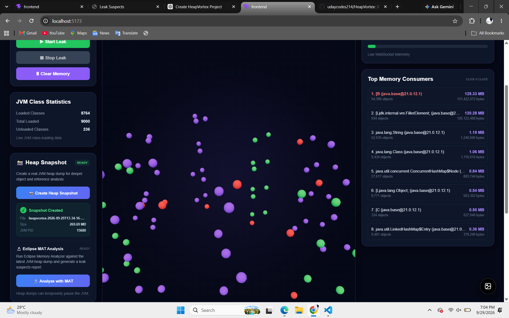
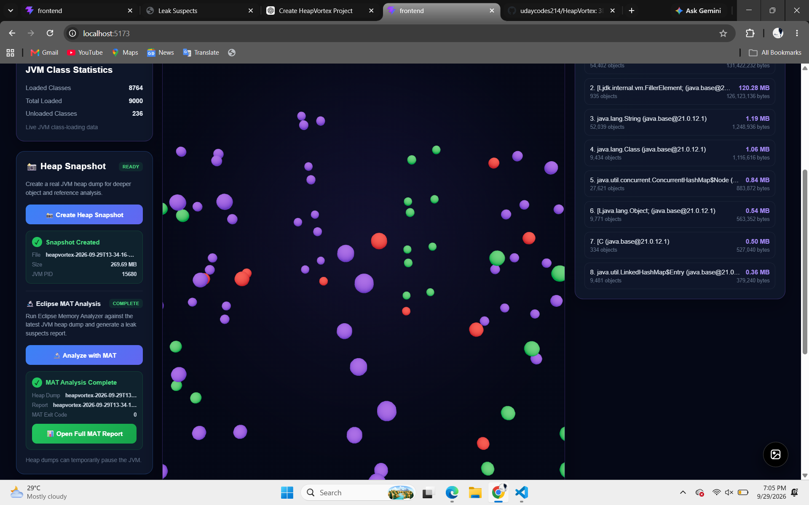
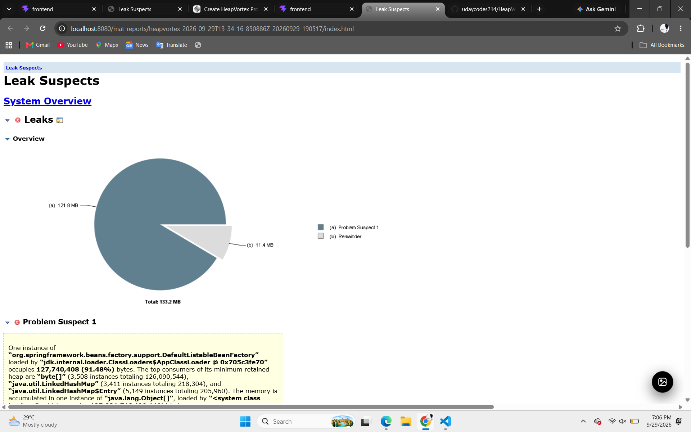

# HeapVortex

## 3D JVM Memory Leak Profiler

HeapVortex is a real-time JVM memory monitoring and memory leak analysis platform built with **Spring Boot, React, WebSocket, Java Instrumentation concepts, and Eclipse Memory Analyzer (MAT)**.

The project provides a visual 3D representation of JVM memory activity and combines live telemetry, heap analysis, leak simulation, class statistics, heap histograms, heap dumps, and Eclipse MAT analysis in a single dashboard.

---

## 🚀 Features
## 📸 Project Screenshots

### 🖥️ Main Dashboard



### 🔥 Memory Leak Simulation

HeapVortex can simulate continuous memory allocation and visualize the increasing JVM heap usage in real time.



### 🛑 Leak Stopped with Retained Memory

Stopping the simulator stops new allocations while previously retained objects remain in memory.



### 📸 Heap Snapshot

HeapVortex can generate an HPROF heap dump of the running JVM.



### 🔬 Eclipse MAT Integration

The generated heap dump can be analyzed automatically using Eclipse Memory Analyzer (MAT).



### 🧠 MAT Leak Suspects Report

The generated MAT report provides retained-memory analysis and identifies potential memory suspects.



### 🧠 Real-Time JVM Memory Monitoring

- Live JVM heap usage monitoring
- Heap used memory
- Heap committed memory
- Heap maximum memory
- Heap usage percentage
- Real-time WebSocket telemetry

### 🌐 3D JVM Memory Visualization

HeapVortex provides an interactive 3D visualization of JVM memory activity using:

- React
- Three.js
- React Three Fiber
- OrbitControls

Memory objects are represented as 3D nodes and updated according to JVM telemetry.

---

### 💥 Memory Leak Simulator

HeapVortex includes a built-in memory leak simulator for testing leak detection.

The simulator can:

- Start simulated memory allocation
- Continuously retain memory
- Stop memory allocation
- Clear retained memory
- Display currently retained memory in MB

The simulator helps reproduce memory growth scenarios in a controlled environment.

---

### 📊 JVM Class Statistics

The dashboard displays live JVM class-loading information:

- Loaded Classes
- Total Loaded Classes
- Unloaded Classes

These values are collected using Java's `ClassLoadingMXBean`.

---

### 🔍 JVM Class Histogram

HeapVortex uses:

```text
jcmd <PID> GC.class_histogram